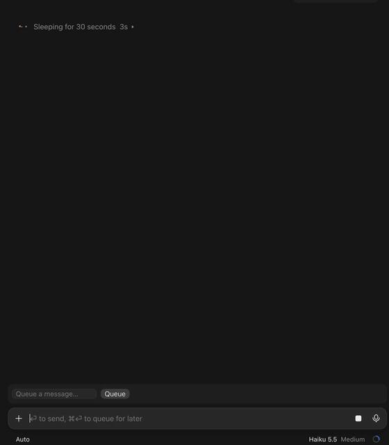
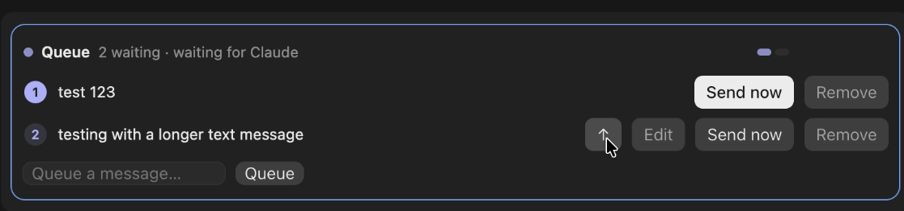
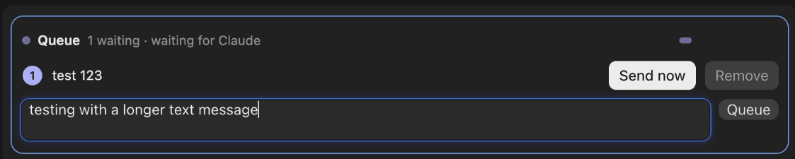
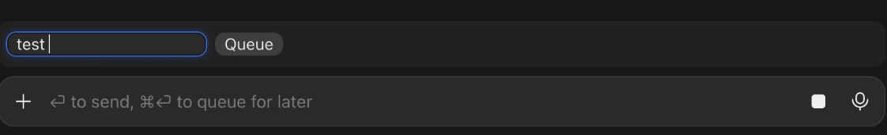

# Queue for Claude Code

**Send a message after Claude finishes what it is doing.**

A message you type while Claude is working goes into the turn that is running. `/queue <message>` holds the message instead and sends it only when Claude is done, including any subagents and background tasks still working. You can line up the next step, or several, while a long task runs.

## Install

At the prompt of a terminal session:

```text
/plugin install queue --marketplace kraevski/claude-mods
```

Answer `y` to add the marketplace, then pick a scope. The mod is active at once, with no restart.

From a shell:

```sh
claude plugin install queue --marketplace kraevski/claude-mods
```

In the desktop app, where `/plugin` does not run: click + next to the prompt box, then Plugins, Add marketplace with `kraevski/claude-mods`, then Add plugin.

## Use

```text
/queue run the tests and summarize any failures
```

Under your `/queue` line, a colored `Queued #1` pill shows the message's place and what it waits for. Once the message goes out, the pill turns to `✓ Sent`. It is sent as your own words. `/queue` with no message shows its usage line.

The band above the prompt shows how many messages wait and what they wait for. It lists the first three, and counts the rest. Each row has **Send now** and **Remove**. Point at a row to get **↑**, **↓** and **Edit** as well. Pointing at a `Queued #n` pill gives Send now, Edit and Remove too. The band is hidden when nothing waits, unless you paused the queue. Other plugins' bands stay in view, under the queue's rows.

In the desktop app, the band and the pill are drawn in the app's own type and colors, light or dark: the band's header shows a slot per waiting message, and each pill shows its message's slot among them. A border frames the band: accent while messages wait, amber while paused.

In the desktop app, text typed while Claude works is held until the turn ends, `/queue` included. So the band shows a "Queue a message" field while Claude works, alone when nothing is queued. It grows from one line to two as you type. Enter there queues the message at once. Edit there opens the message in place, in its band row or its reply row, instead of filling the prompt box.

Queue as many messages as you like. They go out one at a time, in the order you queued them.

### Looks like

In action:



The band above the prompt, with the row buttons revealed on hover:



A longer message in the band:



While Claude works and nothing is queued, the band is just the message field:



### Commands

`<n>` is a message's position among the waiting messages. `@<id>` names it by its id instead, which stays the same as the positions change. `/queue edit` uses ids.

- `/queue list` shows the waiting messages, numbered.
- `/queue rm <n>` removes a message.
- `/queue clear` removes every waiting message.
- `/queue pause` and `/queue resume` hold and release the queue.
- `/queue send <n>` sends a message now, out of turn. See below.
- `/queue edit <n> [text]` replaces a message's text. Without text, it puts `/queue edit @<id> <text>` in the prompt box, for you to change and press Enter.
- `/queue up <n>` and `/queue down <n>` move a message one place.

To queue a word that is also a command, put `--` before it: `/queue -- list` queues the text "list". Without `--`, `/queue rm` with no number, or `/queue list now`, queues its text as a message.

### Send

`/queue send <n>`, or the band's **Send now**, sends a message out of turn.

- While Claude is idle, it is sent at once. Background tasks and a pause do not hold it.
- While Claude is running, the text goes into the prompt box and leaves the queue. Press Enter to feed it into the running turn. Claude reads it at its next tool step. The reply row reads `In the prompt box` until you press Enter, then `✓ Sent`.
- If the prompt box already holds a draft, or there is no prompt box, the message stays queued and a toast says so.
- A message that may have been sent before is not sent this way. `/queue resume` sends it again; `/queue rm` drops it.

### Slash commands

`/queue /name args` queues a slash command. It runs in its place in the queue, and its turn holds the messages behind it until that turn ends. A command that does not start a turn, such as `/compact`, runs and the queue goes on. An unknown command, and `/queue /queue`, are refused when you queue them, and nothing is queued.

### Join queued messages

The `joined` option sends the leading waiting messages as one message, separated by blank lines. It stops at the first queued slash command. It is off by default.

Turn it on in `/config`, in the row **Join queued messages** under this plugin. A change reloads the plugin, and waiting messages stay queued.

### Pauses

The queue pauses when:

- you press Esc during a turn, and something is queued;
- a turn ends on an API error or a refusal, and something is queued;
- a queued command fails to run;
- a message could not be sent, or Claude Code did not take it (the message stays queued, and a toast says why);
- a restart or `/clear` brings messages back (see How it works);
- you run `/queue pause`.

The band says why, and shows **Resume** while paused. `/queue resume` or **Resume** continues. Emptying the queue ends a pause from an interrupt, an error, a refusal, a failed command, a message Claude Code did not take, or a restore. It does not end a `/queue pause`.

## How it works

A queued message goes out only when Claude is completely finished: the main turn, every subagent still listed as running, and every background task (shell commands and the like) that the Stop event reports.

- Releases come from events: a Stop, the start and end of a turn, a subagent finishing, and the session starting. The queue does not check on a timer. A zero-delay timer runs the check right after an event.
- One message is sent per Stop, in order. The next one waits for the Stop that ends the turn of the one before.
- A message is marked as sending before it goes out, so it cannot be sent twice.
- If the send fails, a toast says "The queued message could not be sent. The queue is paused." The message stays in the queue, flagged as possibly sent, and the queue pauses. Resume sends it again; `rm` drops it.
- The queue is saved after each change, under the session's id. After `claude --resume` or `claude --continue` of the same conversation, or `/clear` in the same window, the waiting messages come back paused. A message that was mid-send is flagged "may have been sent". Saved queues not written for 7 days are dropped.
- A brand-new `claude` starts with an empty queue.
- `/reload-plugins` keeps the live queue as it is.

## What it reads and sends

- It reads the text you pass to `/queue`, and sends it to Claude in the same session, as your own words. A queued slash command is run instead.
- It reads the session's list of subagents and the Stop event's list of background tasks, to see what is still running.
- It reads the list of commands, to check a queued command exists when you queue it.
- It reads the prompt box, to check for a draft before it fills the box (for Send while Claude runs, and for Edit).
- It saves the queue in the plugin's store: a JSON file under your Claude Code configuration directory, one entry per session. The entry is deleted when the queue empties, unless the queue is paused, and dropped after 7 days without a change.
- It makes no network calls.

## Limits

- Claude sees the `/queue` rows, queued text included. The plugin tells it not to act on that text until it's sent. In live checks it didn't act on it early, but it may still mention queued messages, and it can't see removals made from the band. A plugin can't hide the rows.
- Where an organisation manages Claude Code, its settings can stop this plugin's hooks from running, Stop included. The queue then can't see when Claude finishes there.
- `claude plugin validate` lists the Stop hook as a gating hook without a `.catch`. Validation still passes, and this is harmless.
- After a mid-turn Send, the next prompt you submit marks the message `✓ Sent`, even if you changed or replaced its text in the box first.

## Development

Load the folder for one session:

```sh
claude --plugin-dir .
```

Check and test it from the repository root:

```sh
claude plugin validate .
claude plugin test .
```

Type-check with the declarations Claude Code writes beside the mod when it loads from a folder:

```sh
npx -p typescript tsc -p .
```

## License

MIT. See [LICENSE](LICENSE).
